<div align="center">


# LastSeenIMD — See What Happened to Your Wallet

**A free, beginner-first wallet forensics tool. Paste an address: it finds stolen keys, sweepers and drains across 28 EVM chains and Solana, follows the money, and explains it all in plain words.**

*Every theft leaves a trail. Most victims just never get shown it.*

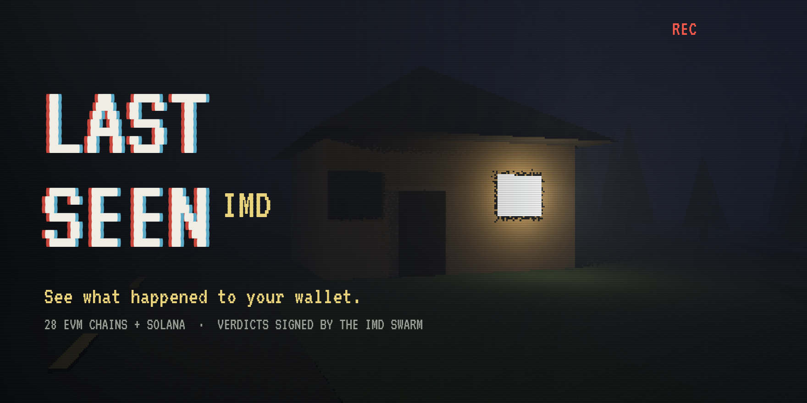


[**Live App**](https://lastseen-4pu.pages.dev) · [Launch Film](docs/launch.mp4) · [One-Page Write-Up](WRITEUP.md) · [Registry Contract](contracts/)

Built for the **Identity MD (IMD) Hackathon**, October 2026.

**First real case: a compromised wallet scored 97/100. The sweeper was found taking funds with its own transactions on 5 chains, one of them an EIP-7702 transaction only the stolen key could sign.**

</div>

---

## Table of Contents

1. [The Story (plain English)](#the-story-plain-english)
2. [The Insight in One Sentence](#the-insight-in-one-sentence)
3. [A Real Case — Real Chain Data](#a-real-case--real-chain-data)
4. [How Detection Works — Step by Step](#how-detection-works--step-by-step)
5. [The IMD Swarm Is the Judge](#the-imd-swarm-is-the-judge)
6. [Two AI Models, Two Jobs](#two-ai-models-two-jobs)
7. [The Interface: A Horror Game About Your Own Wallet](#the-interface-a-horror-game-about-your-own-wallet)
8. [Screenshots](#screenshots)
9. [The Launch Film](#the-launch-film)
10. [What Makes LastSeenIMD Original](#what-makes-lastseenimd-original)
11. [Repository Layout](#repository-layout)
12. [Quick Start](#quick-start)
13. [The Build Log](#the-build-log)
14. [Honest Assumptions](#honest-assumptions)
15. [Tech Stack](#tech-stack)
16. [License & Disclaimer](#license)

---

## The Story (plain English)

In 2025, **80,000 people** had a personal crypto wallet emptied, and **$713 million** was taken that way (Chainalysis, Dec 2025). Drainer victims lost **about $790 each** (Scam Sniffer 2025). Most of them are not rich, and almost none of them get help: the best-known investigator in crypto has said publicly that he only looks at cases above **$250,000** per victim.

What those people get instead is a block explorer they cannot read, and a stranger in their DMs offering to "recover" the money for a fee, which is a second scam.

LastSeenIMD is the friend who can read the explorer. You paste a wallet address and it:

1. **Checks 28 EVM chains and Solana** to find every place the wallet has been used
2. **Looks for the fingerprints of a stolen key** — someone else signing transactions that move your money
3. **Follows the money** two hops deep, and names the exchange where it was cashed out
4. **Tells you, in plain words**, what happened, how sure it is, and what to do now
5. **Asks the IMD agent swarm to sign the verdict on chain**, so the attacker lands on a public do-not-send list every wallet can read

It is free. You never have to connect a wallet to look. And it says plainly that it traces and explains; it does not recover funds.

---

## The Insight in One Sentence

> *"A stolen key leaves one fingerprint nobody can fake: your money leaving in transactions you did not send."*

Approvals, phishing sites and scam tokens are all noise around that one fact. If a different address pays the gas to move your funds — or uses an EIP-7702 signature that only your private key can make — someone else controls the wallet. LastSeenIMD checks exactly that, on every chain, and only then looks at everything else.

---

## A Real Case — Real Chain Data

The first wallet tested was the author's own: **`0xc652…f2d3`**, which kept losing every deposit within minutes. The previous version of this app, which only read Ethereum, scored it **0/100**. The current one:

| Finding | What the chain shows |
|---------|----------------------|
| **Verdict** | **COMPROMISED — 97/100** |
| Chains checked | 28 EVM chains (15 with activity; the 10 most active read in full) |
| Sweeper | `0xef94…28a5` — **9 transfers** taken on **Base, Optimism, Polygon, Soneium and HyperEVM** |
| How it took them | It sent the transactions itself ("the receiver" signed), one of them an **EIP-7702 transaction** carrying authorizations only this wallet's key can sign |
| Delegations | The wallet is delegated to an **unrecognised contract on 5 chains — a different one on each** |
| What the delegate can do | AI audit of the Base delegate: `withdrawNative`, `withdrawToken` and arbitrary `execute` — it can empty the wallet. Source code: **not public** |
| Address poisoning | **18 fake transfers** to look-alike addresses planted in the wallet's history |
| Second opinion | SubQ, on the full evidence: **93% chance the key is stolen**, most likely attack "stolen key" (84%). Its numbers move with the evidence it is given |

The verdict question for this case was run through IdentityMD's free `POST /requests/check`: **no blockers**, with 1,036 agents online.

---

## How Detection Works — Step by Step

Every rule below is implemented in [`functions/api/`](functions/api/). Under each one is what it means in plain English.

### Step 1 — Find where the wallet lives (`discover.js`)

One small batched request per chain (nonce, balance, code) across **28 EVM chains**. The 10 most active chains are then read in full; the rest are named on screen. Delegated chains are always read first.

*Plain English: before looking at what happened, find every neighbourhood the wallet has lived in.*

### Step 2 — The sweeper test (`scan.js` → `findSweeper`)

For the latest outgoing transactions on each chain, read who actually signed them.

| Signal | Rule | Plain English |
|--------|------|---------------|
| **Self-pulling receiver** | `tx.from == transfer.to` and `tx.from != wallet`, for a real (priced) asset | The thief sent the transaction that took your money |
| **7702 takeover** | transaction type `0x4` sent by someone else, on a chain where the wallet is delegated to an unrecognised contract | A signature only your key can make was used against you |
| **Fake-token guard** | unpriced tokens are ignored | Anyone can deploy a token that *claims* a transfer from you; only real assets count |
| **Service guard** | labelled exchanges, swaps and bridges are excluded | Relayers and solvers sign for you legitimately |

### Step 3 — Delegations (EIP-7702)

`eth_getCode` returning `0xef0100…` means the wallet runs a contract's code. Known wallet software (MetaMask, Ambire, Uniswap Calibur, Coinbase smart wallet) is recognised; anything else is checked against Sourcify for public source code and flagged.

### Step 4 — Address poisoning (`findPoisoning`)

Group every counterparty by its first 4 and last 4 hex characters. Two different addresses with the same ends, where one carries almost no value, means a look-alike was planted in the history.

### Step 5 — The burst test (`findIncidents`)

Three or more different assets leaving for **one** unlabelled address within an hour, worth over $100 — the usual shape of an approval or permit drain.

### Step 6 — The risk score

```
score = 0.40·PastDrain + 0.30·RiskyApprovals + 0.15·OpenAllowances + 0.30·UnknownDelegation + 0.15·BeingTargeted
score = max(score, floor[compromise level])        floors: confirmed 97 · likely 85 · suspected 60
```

Each part is 0–100 and shown on a radar chart, so a user can see *why* the number is what it is.

### Step 7 — Follow the money (`trace.js`)

Two hops out from the sweeper (or the drain receiver), keeping the largest edges, labelled with **104,212 known addresses** (exchanges, bridges, mixers, sanctioned and flagged addresses — built from the MIT-licensed [eth-labels](https://github.com/dawsbot/eth-labels) dataset plus Relay, LI.FI and major exchange hot wallets).

**Exchange deposit detection:** an unlabelled address that forwards ≥70% of its transfers to one exchange is that exchange's deposit address for somebody's account. That is the evidence police and exchanges act on.

### Step 8 — Solana (`sol.js`)

Solana has no 7702, so the fingerprints differ: funds leaving in transactions **the owner did not sign** (a delegate or another signer), token accounts that **still carry a delegate**, and the same burst test. Balance changes are rebuilt from pre/post balances, so nothing depends on an indexer.

### Step 9 — Off-chain (`mentions.js`)

Public posts on X that contain the address (TikHub search via [Monid](https://monid.ai), $0.001 a search, cached a day), plus the names the owner published themselves: ENS, Basename, Farcaster, Lens, X and GitHub (web3.bio). A mention is never treated as ownership, and the page says so.

---

## The IMD Swarm Is the Judge

A scan is our opinion. A swarm verdict is a fact other apps can rely on. [`LastSeenRegistry`](contracts/src/LastSeenRegistry.sol) turns a case into a yes/no question the IdentityMD agents answer **from chain data**, and only a signed "yes" changes anything.

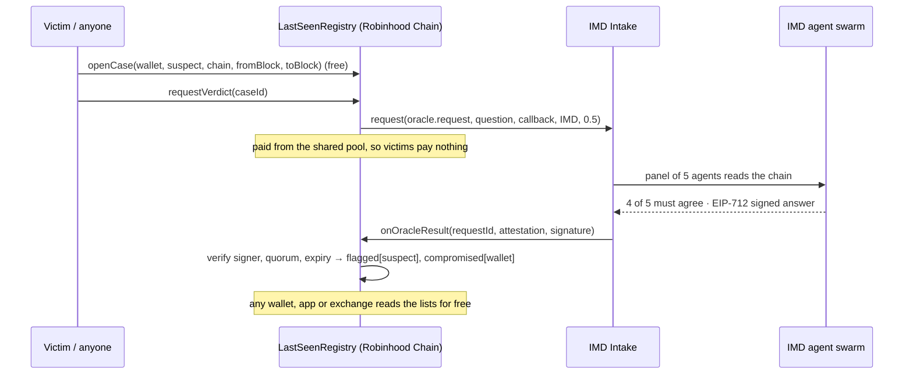

**Then the hunt starts.** A confirmed case can carry an IMD bounty. Hunters submit leads one hop at a time — "the sweeper sent funds to L" — each verified by the swarm the same way, and each confirmed hop pays the hunter **a quarter of what is left**. The next hunter starts from L. Hop by hop, the trail grows toward the exchange.

| Guarantee | How |
|-----------|-----|
| Only the oracle can answer | Callback accepted only from the Intake, only for a request this contract made, only once |
| Only a real panel counts | EIP-712 signature from the IMD attester for **this** contract and chain; `agreed ≥ quorum`, panel ≥ 5, not expired |
| No wasted payments | Cases are limited to the 5 chains the oracle reads (Ethereum, BNB, Robinhood Chain, Base, Arbitrum) |
| No rug | The owner can update oracle settings (IMD versions them) but cannot change the token while the contract holds funds, and has no withdraw |

**13 Foundry tests** cover confirmed and rejected verdicts, forged signatures, signatures for another contract, below-quorum panels, non-Intake callers, replays, the free pool, the hop-by-hop bounty, unsupported chains, and the callback selector `0x510379c7` from IMD's docs.

---

## Two AI Models, Two Jobs

| Model | Where it runs | Job |
|-------|---------------|-----|
| **GLM 5.3** (falls back to GLM 5.3 Flash) | Cloudflare Workers AI | Writes the analyst's note in plain words, and **audits contracts** — from public source when Sourcify has it, otherwise from the function signatures found in the bytecode, and it says which |
| **SubQ Snap Preview** | SubQ Decisions API | A fast typed second opinion: probability the key is stolen, the most likely attack, and urgency — shown as meters |

Both models see only the evidence on the page. The red verdict banner comes from on-chain facts, never from a model.

---

## The Interface: A Horror Game About Your Own Wallet

Losing money feels like a horror story, so the app is styled like one — after the *Fears to Fathom* games: first-person, late at night, ordinary places, the story told through text messages.

- **A PS1-style 3D world** in Three.js: rendered at 384×216 and stretched, flat-shaded, vertices snapped to a coarse grid, heavy fog. A low-poly house, a failing street lamp, rain — and a hooded man who appears by the house for a few seconds every 40.
- **The case opens like an episode:** a black card types *"What follows was rebuilt from public blockchain records"*, the camera walks up to the door, the tape rewinds.
- **The story arrives as texts** on a phone, with typing dots and timestamps; yellow subtitles; an *Objectives* checklist instead of "next steps".
- **Sound:** real CC0 recordings (Kenney, Freesound) for every click, message and alarm, placed from the interface's own timing; a worn-tape piano score played live in the browser that turns darker when a case goes bad.
- **20+ chart types** (ECharts): gauge, radar, pie, sunburst, Sankey, force graph, funnel, tree, stacked bars, waterfall, donut, treemap, scatter, bubble, calendar heatmap, hour heatmap, column+line, timeline, probability meters.
- **Accessibility:** a "tape effects" switch turns every effect off; `prefers-reduced-motion` is respected.

---

## Screenshots

| | |
|:---:|:---:|
| 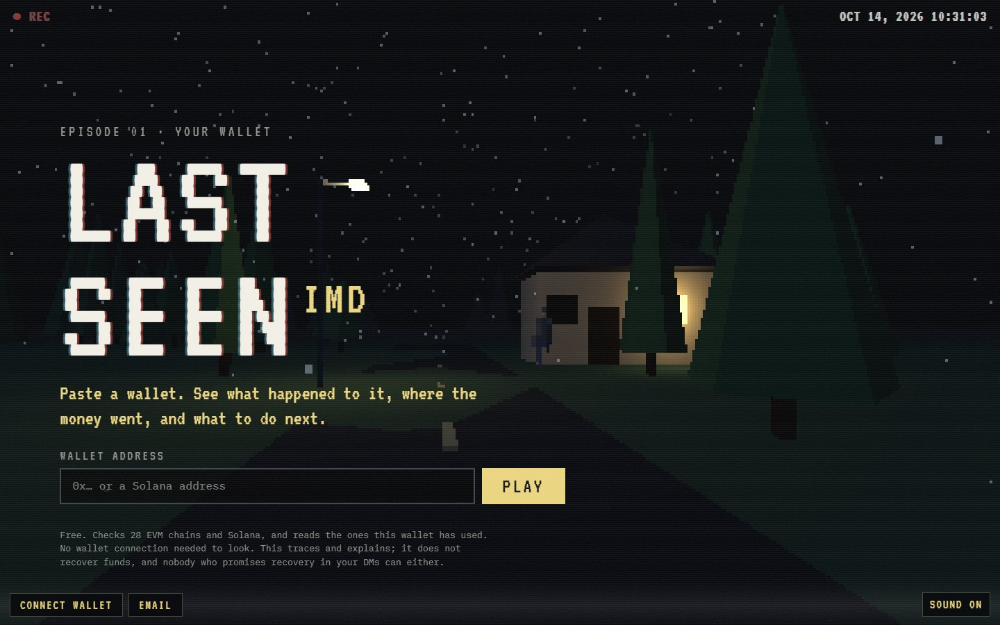<br/>**Title screen** — the house, the lamp, the man | 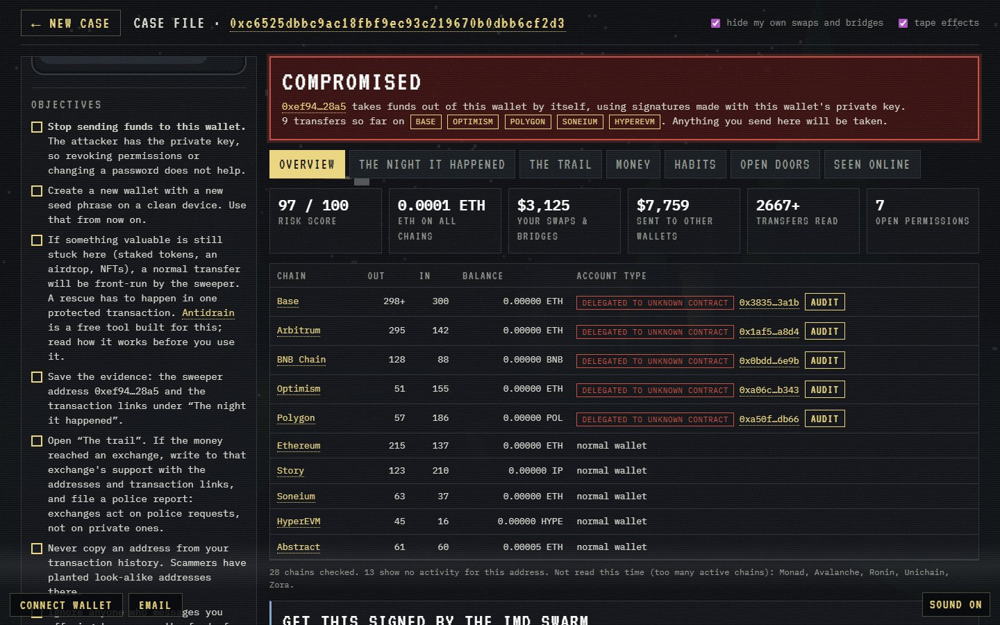<br/>**Case file** — verdict, chains, delegations |
| 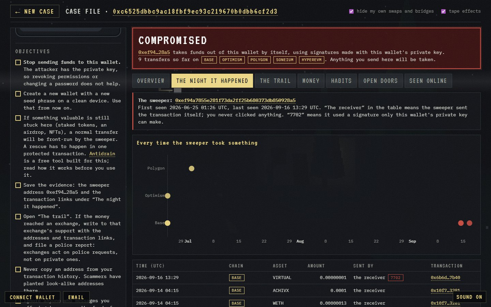<br/>**The night it happened** — every sweep, who signed it | 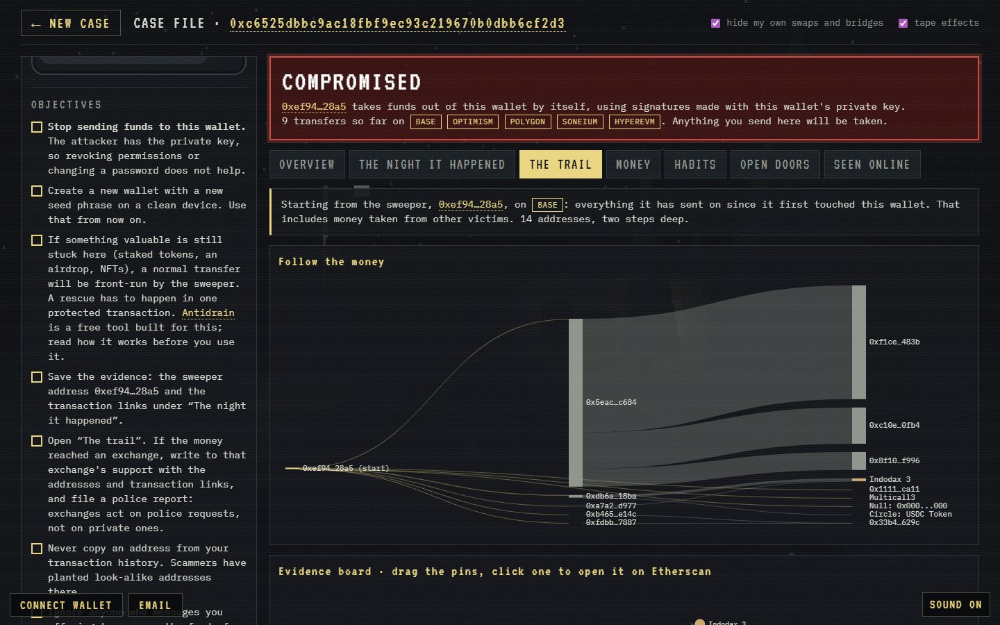<br/>**The trail** — Sankey of where the money went |
| 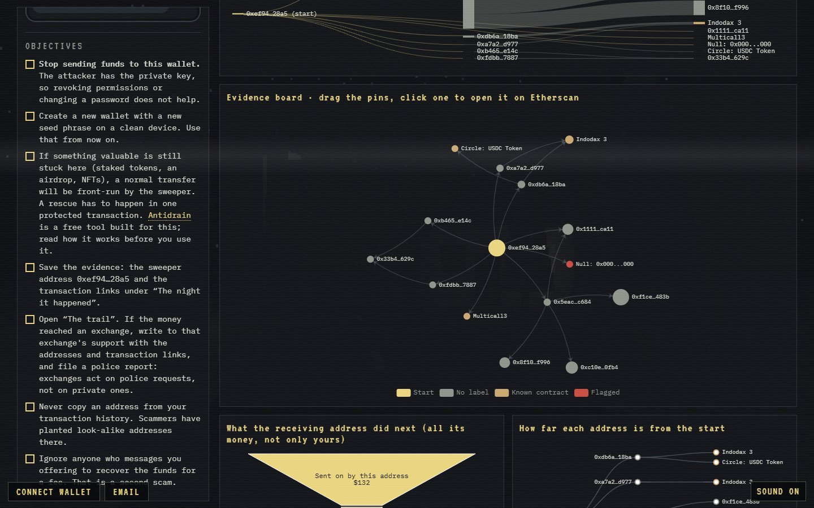<br/>**Evidence board** — drag the pins, click to open | 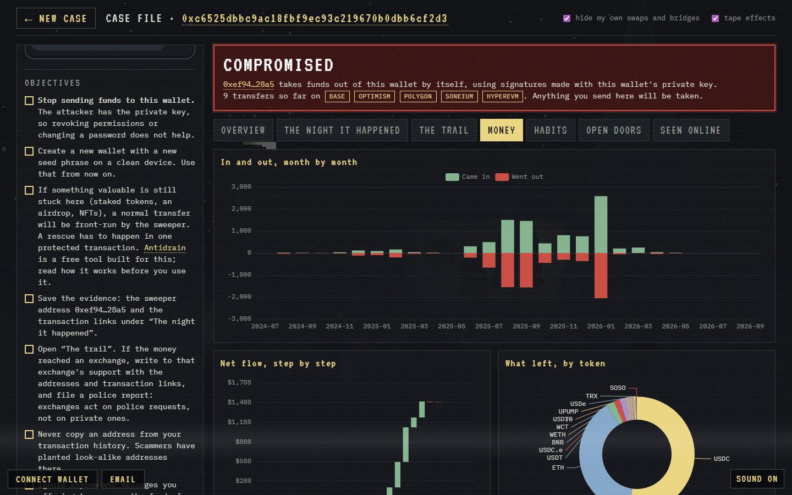<br/>**Money** — month by month, by token |
| 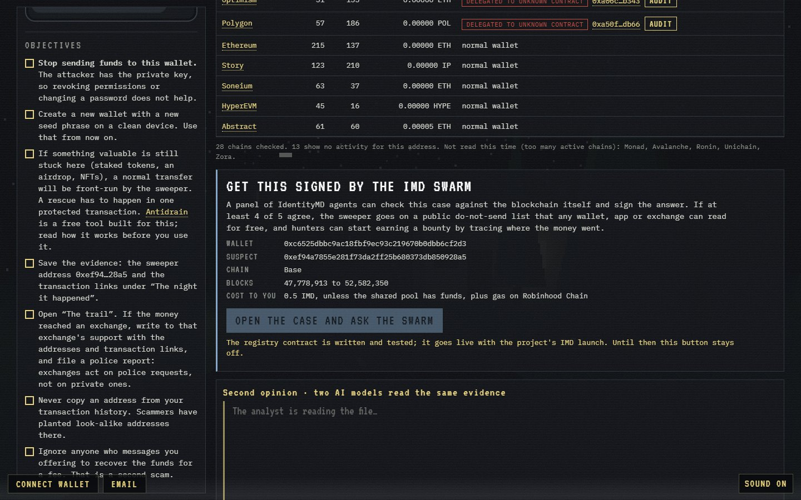<br/>**Swarm panel** — the case, ready for IMD agents to sign | 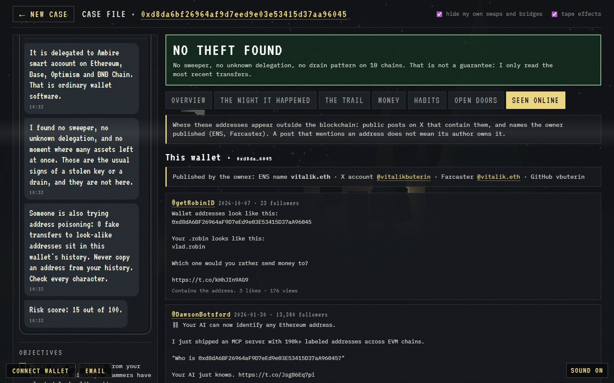<br/>**Seen online** — posts and published names (vitalik.eth shown) |

---

## The Launch Film

<div align="center">
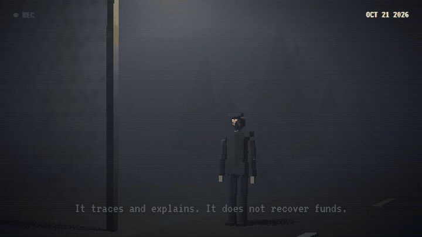

**[▶ Watch the 42-second launch film (MP4, 1080p, with sound)](docs/launch.mp4)**
</div>

Made entirely from code, in the same style as the app:

| Layer | Tool | Source |
|-------|------|--------|
| 3D shots | **Blender 5.2**, scripted (low-poly scene, fog volume, failing lamp, hand-held camera, a modelled low-poly man) | [`film/blender/scene.py`](film/blender/scene.py) |
| Motion | **HyperFrames** — one HTML composition with a seekable GSAP timeline, rendered to MP4 | [`film/hyperframes/index.html`](film/hyperframes/index.html) |
| Sound | The app's piano score written out note by note, rain, and recorded CC0 effects placed from the timeline's own cue times, mixed to −15 LUFS | [`film/audio/build_audio.py`](film/audio/build_audio.py) |
| Logo | Pixel art drawn on a 32×32 grid, VT323 wordmark | [`film/logo/make_logo.py`](film/logo/make_logo.py) |

<div align="center">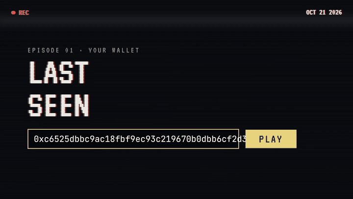</div>

---

## What Makes LastSeenIMD Original

1. **It answers the victim's actual question** — *"how did this happen?"* — instead of showing a graph and leaving them to it.
2. **Signer forensics across 28 chains.** Most tools check approvals. The fingerprint of a stolen key is *who signed the outflows*, and with EIP-7702 that question now matters on every EVM chain.
3. **The swarm is the judge, not a checkbox.** The registry only changes on a verdict 4 of 5 independent agents signed from chain evidence; the bounty pays only for swarm-verified hops.
4. **Free where it matters.** Looking needs no wallet. Verdicts are paid from a shared pool. Hunters, not victims, pay for leads.
5. **Honest by design.** It never promises recovery, warns about recovery scams, labels uncertain AI output, and states what it did not read.

---

## Repository Layout

```
lastseenimd/
├── public/                    # the app (static, served by Cloudflare Pages)
│   ├── index.html · style.css # tape look, phone UI, case file
│   ├── app.js                 # case flow, 20+ charts, swarm panel, revoke, Solana view
│   ├── scene.js               # Three.js PS1 renderer: house, lamp, rain, the man
│   ├── sound.js               # CC0 recordings + live piano score (two moods)
│   ├── privy.bundle.js        # wallet connect (built from wallet/)
│   ├── labels/                # 104,212 labelled addresses, sharded by prefix
│   └── sfx/                   # CC0 sounds + CREDITS.md
├── functions/                 # Cloudflare Pages Functions (keys stay server-side)
│   ├── _lib.js                # chains, batched RPC, prices, labels, GoPlus
│   ├── _ai.js                 # GLM 5.3 (Workers AI) + SubQ Decisions
│   └── api/
│       ├── discover.js        # 28-chain activity check
│       ├── scan.js            # sweeper · 7702 · poisoning · drains · risk · story
│       ├── trace.js           # two-hop trail + exchange deposit detection
│       ├── sol.js             # Solana scan
│       ├── mentions.js        # X posts + published names
│       ├── ai.js · audit.js   # analyst note · contract audit
│       ├── registry.js        # reads LastSeenRegistry on Robinhood Chain
│       └── _middleware.js     # per-visitor rate limits
├── contracts/                 # Foundry: LastSeenRegistry + 13 tests + deploy script
├── wallet/                    # Privy connect island (React, bundled with esbuild)
├── film/                      # Blender, HyperFrames, soundtrack, logo, screenshot scripts
├── data/build_labels.py       # rebuilds public/labels from eth-labels
├── docs/                      # logo, cover, screenshots, launch film
├── WRITEUP.md                 # one-page write-up
└── SUBMISSION.md              # hackathon entry text
```

---

## Quick Start

```bash
# 1. Secrets for local development (never committed)
cp .dev.vars.example .dev.vars        # fill in ALCHEMY_KEY, SUBQ_API_KEY, MONID_API_KEY

# 2. Run the app locally
npx wrangler pages dev --port 8799

# 3. Deploy to Cloudflare Pages
npx wrangler pages deploy --project-name lastseen
npx wrangler pages secret put ALCHEMY_KEY --project-name lastseen   # and the others

# 4. Contracts
cd contracts && forge test            # 13 tests

# 5. Rebuild the wallet bundle after editing wallet/src
cd wallet && npm install && npm run build

# 6. Rebuild the address labels
curl -L -o data/accounts.csv https://raw.githubusercontent.com/dawsbot/eth-labels/v1/data/csv/accounts.csv
cd data && python build_labels.py
```

The Alchemy key needs the networks you want enabled in the Alchemy dashboard; chains that are not enabled are reported as unreadable rather than failing the scan. Launching the registry through IdentityMD is described step by step in [`contracts/LAUNCH.md`](contracts/LAUNCH.md).

---

## The Build Log

| Date | Shipped |
|------|---------|
| **8 Oct** | Research (victims, competitors, IMD protocol), first scan + trail + 20 charts, PS1 title scene, deployed |
| **11 Oct** | A real compromised wallet scored 0 → rebuilt as multi-chain signer forensics: sweepers, 7702 delegations, poisoning (scored 97). GLM 5.3 + SubQ, contract audits, Privy, sound, opening card, 28-chain discovery, revoke, deposit-address detection |
| **11 Oct** | Launch film: Blender shots, HyperFrames composition, scored soundtrack, logo |
| **14 Oct** | LastSeenRegistry (swarm verdicts + hop-by-hop bounties, 13 tests, question accepted by IMD's checker), Solana scan, X/ENS/Farcaster lookups, rate limits, the man on the title screen |

---

## Honest Assumptions

- **Recent history only.** Each chain is read up to 300–500 transfers each way, and the signer check covers the latest 40 outgoing transactions per chain. A theft older than that can be missed; the page says how much it read.
- **Prices are today's prices** (DefiLlama), not the price on the day of the theft.
- **Labels are incomplete.** 104,212 public labels cover major exchanges and bridges, not every deposit address. Deposit detection is a heuristic (≥70% forwarded to one exchange).
- **Nothing is traced inside an exchange.** No tool can; the exchange can, on a police request. The app names the exchange and gives the evidence.
- **AI output is labelled as AI.** The audit says when it only saw bytecode, and both models can be wrong.
- **The registry is not yet deployed.** It is written and tested; it launches through IdentityMD on Robinhood Chain. No real swarm verdict has run yet.
- **Wallet connect and in-app revoke** are built but have not been tested end to end with a real wallet.

---

## Tech Stack

Vanilla JavaScript · Three.js · ECharts · Web Audio API · Cloudflare Pages + Pages Functions + Workers AI (GLM 5.3) · SubQ Decisions API · Alchemy (28 EVM chains + Solana) · DefiLlama · GoPlus · Sourcify · OpenChain · Monid (TikHub X search) · web3.bio · Privy (React, esbuild) · Solidity 0.8 + Foundry + OpenZeppelin 5.4 · IdentityMD oracle (Intake, EIP-712 attestations) · Blender 5.2 · HyperFrames · ffmpeg · Pillow · NumPy

---

## License

MIT — see [LICENSE](LICENSE). Address labels derive from [eth-labels](https://github.com/dawsbot/eth-labels) (MIT). Sounds are CC0 — see [`public/sfx/CREDITS.md`](public/sfx/CREDITS.md). The VT323 font is under the SIL Open Font License.

---

## Disclaimer

Educational hackathon project. LastSeenIMD reads public blockchain data and explains it; it does not recover funds, and nothing here is legal or financial advice. Anyone who promises to recover stolen crypto for a fee is almost certainly running a second scam.
